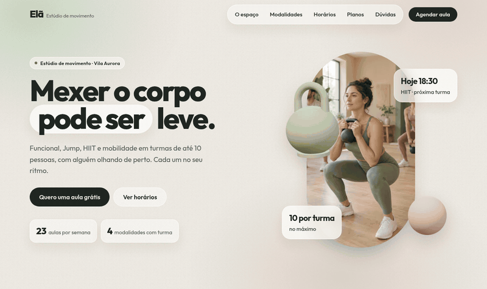
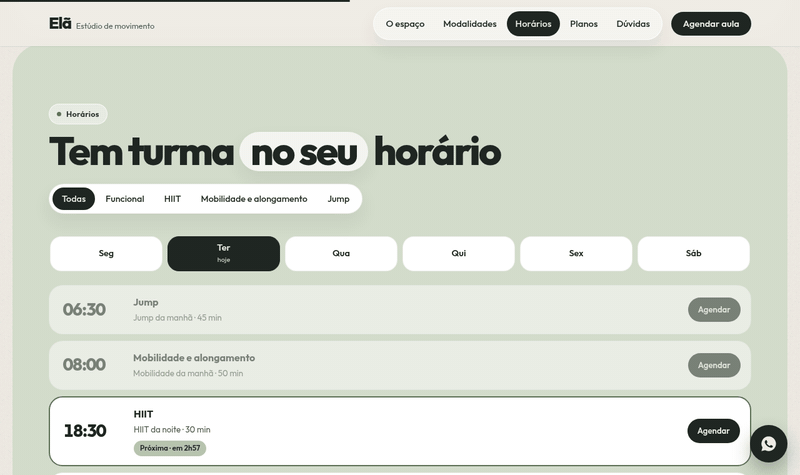
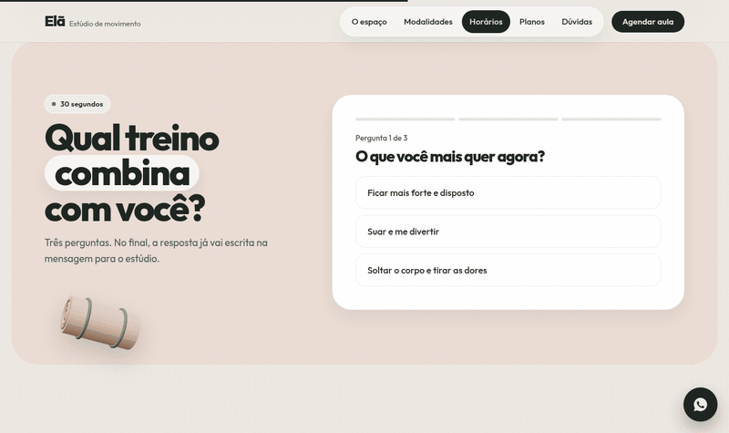
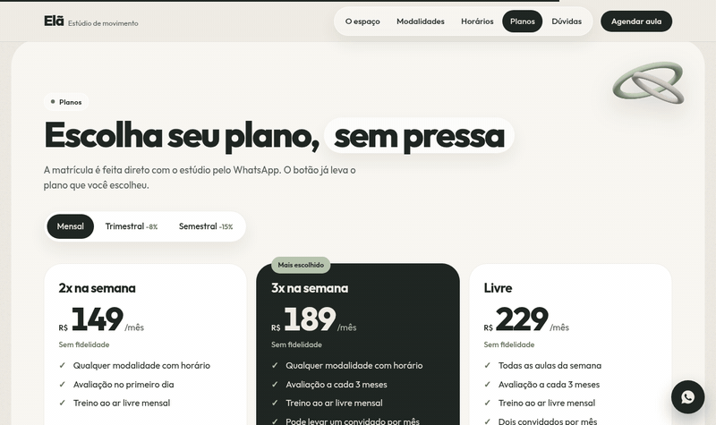
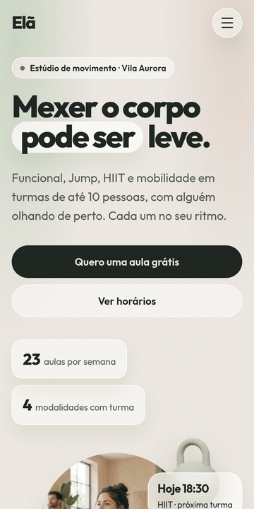

# Elã · Estúdio de movimento

> **Projeto fictício, feito para estudo e portfólio.** A Elã não existe: a marca, as pessoas, os textos, os preços e os horários foram inventados. As fotos foram geradas por IA e não mostram pessoas reais. Nada é vendido aqui.

Catálogo de uma página para um estúdio de movimento de bairro (funcional, Jump, HIIT, mobilidade e treinos ao ar livre). A pessoa conhece o espaço, vê os horários e os planos, faz um quiz rápido e fala com o estúdio pelo WhatsApp com a mensagem já escrita.

Feito com **HTML, CSS e JavaScript puros**, sem framework.



---

## O site em ação

### Horários com a próxima aula

A agenda da semana tem abas por dia (com navegação pelo teclado), filtro por modalidade e destaque da **próxima aula**, calculada pela hora do aparelho. O topo do site também mostra a próxima turma num cartão de vidro.



### Quiz e mensagem pronta para o WhatsApp

Três perguntas indicam a modalidade que combina com a pessoa. Cada botão do site monta a própria mensagem: o plano e o período escolhidos, a aula e o horário, o resultado do quiz.

Como o estúdio é fictício, os botões funcionam em **modo demonstração**: em vez de abrir o WhatsApp (um número inventado poderia ser de alguém real), aparece um aviso com a mensagem que seria enviada.



### Planos com desconto por período

Trocar entre mensal, trimestral e semestral recalcula o preço, o total e a economia de cada plano.



### Feito para o celular

No celular as listas viram carrosséis de arrastar, o menu vira um painel e uma barra fixa deixa o "Agendar" sempre à mão.



---

## O que eu usei e aprendi

- **Conteúdo separado do código:** horários, planos, modalidades, depoimentos, quiz e dúvidas ficam em arquivos JSON (`public/data/`). Só o `js/api.js` lê esses dados, então trocar os JSON por uma API no futuro muda um arquivo só.
- **Uma seção por arquivo** em `js/secoes/`. Se um JSON tiver erro, só aquela seção some, o resto da página continua funcionando.
- **Funções puras com testes** (`node --test`): o cálculo da próxima aula (`js/agenda.js`) e a montagem das mensagens (`js/whatsapp.js`).
- **Visual em tokens** (`css/tokens.css`): paleta pastel sálvia e argila, fonte Outfit, cartões de vidro fosco no topo e um toque de neon só quando a pessoa interage (hover, foco e toque).
- **Objetos 3D sem 3D em tempo real:** a kettlebell, o trampolim, o colchonete e os elásticos foram modelados em código com Three.js (`scripts/3d/`), renderizados com fundo transparente e exportados como WebP de 4 a 7 KB. O site só carrega as imagens prontas.
- **Imagens leves:** um script com `sharp` gera AVIF e WebP em vários tamanhos, e o navegador baixa só o que a tela precisa (`<picture>`, `srcset`, `loading="lazy"`).
- **Acessibilidade:** link para pular o menu, foco visível, abas e filtros com `aria`, `<dialog>` que devolve o foco ao botão que o abriu e respeito a "reduzir movimento".

## Rodando no seu computador

O site usa módulos JS e lê arquivos JSON, então precisa de um servidor local (não abre com duplo clique):

```bash
npm install
npm run dev        # abre em http://localhost:3000
npm test           # testes das funções puras
```

Outros comandos:

```bash
npm run imagens      # otimiza as fotos de fotos-originais/ para public/img/
npm run render:3d    # abre o estúdio 3D em http://localhost:3020 para renderizar os objetos
npm run imagens:3d   # otimiza os objetos 3D para public/img/3d/
npm run gifs         # grava os GIFs deste README com o Chrome sem janela (site rodando em npm run dev)
```

## Estrutura

```
public/
├── index.html        estrutura e textos fixos
├── css/              tokens.css (cores e fontes), base.css, secoes.css
├── js/               main.js (entrada), api.js (dados), agenda.js, whatsapp.js,
│   │                 imagens.js, objetos3d.js, interface.js, efeitos.js, carrossel.js
│   └── secoes/       um arquivo por seção
├── data/             conteúdo editável em JSON
└── img/              fotos e objetos 3D otimizados
scripts/              otimização de imagens, estúdio de render 3D e gravação dos GIFs
tests/                testes com node --test
```

---

[LinkedIn](https://www.linkedin.com/in/manoela-silva-592641221/)
